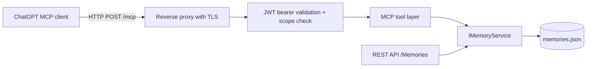

# MCP Interface Reference

This document describes the Model Context Protocol (MCP) interface exposed by GPT Memory Store as a second inbound boundary alongside the existing REST API.

## Overview

The server implements MCP over stateless Streamable HTTP. The endpoint is disabled by default and requires OAuth 2.1 bearer-token authentication when enabled. All tools operate on the same in-process `IMemoryService` and shared JSON memory store as the REST API; there is no per-client isolation. MCP clients must be treated as sharing full read and write access to every stored memory.

## Architecture



- Transport: stateless Streamable HTTP, no session affinity; suitable for load balancing.
- Protocol revision negotiation is handled by the SDK; sessions, sampling, and elicitation are disabled in stateless mode.
- The REST API remains fully available and is not affected by MCP configuration.

## Endpoint And Transport

| Item | Value |
|------|-------|
| Route | `/mcp` |
| Method | POST (JSON-RPC over Streamable HTTP) |
| Default state | Not mapped (returns 404) |
| Enabled state | Requires authentication |
| Protocol version header | `MCP-Protocol-Version` |

The endpoint is mapped only when `McpSettings:IsEnabled` is `true`.

## Authentication

The application acts as an OAuth 2.1 resource server. It never issues tokens and supports no API keys on `/mcp` because ChatGPT cannot present custom keys.

- Tokens must be signed JWTs from the configured authorization server.
- Validation covers signature, issuer, audience, and expiration, plus the configured scope claim (`scope` or `scp`).
- Unauthenticated or invalid requests receive `401` with a `WWW-Authenticate` header pointing at the protected-resource metadata.
- Authenticated but unauthorized requests (missing scope) receive `403`.
- Discovery is public at `/.well-known/oauth-protected-resource/mcp` and advertises the resource, authorization server, and supported scopes.

Configuration is described in the [Configuration Reference](configuration.md). The server validates tokens only; configuring the authorization server and registering the ChatGPT integration happen externally.

HTTPS is mandatory: authority and resource settings must use HTTPS and deployment must terminate TLS before the endpoint is reachable over a public network.

## Tools

All tools return structured content. Read tools are idempotent; update and delete are marked destructive.

| Tool | Access | Idempotent | Input | Result |
|------|--------|------------|-------|--------|
| `memory_get_all` | Read | Yes | none | Complete collection, ordered by updated then created timestamp descending, with `count` |
| `memory_get` | Read | Yes | `id` | Single memory record |
| `memory_add` | Write | No | `content`, `source`, `confidence` | Created record including generated `id` |
| `memory_update` | Write | Yes | `id`, `content`, `source`, `confidence` | Updated record; creation timestamp preserved |
| `memory_delete` | Write | Yes | `id` | Confirmation with `id` and `deleted` |

### Record Result Shape

```json
{
  "id": "0d7d6955-c4b4-497e-b043-d0c83863f182",
  "createdDateTime": "2012-09-05T10:30:00.0000000+00:00",
  "updatedDateTime": null,
  "content": "Solaire of Astora enjoys Dark Souls.",
  "source": "An explicit user request.",
  "confidence": 0.613
}
```

### Validation Rules

- `confidence` must be between `0` and `1`.
- `id` must be non-blank where required.
- Validation errors surface as protocol errors and never trigger service calls.

## Error Behaviour

- Validation failures produce parameter-annotated protocol errors.
- Unknown identifiers on `memory_delete` produce a controlled protocol error stating the memory was not found.
- Other service failures are converted by the SDK into generic protocol errors; persistence details, stack traces, and credentials are never exposed to clients.
- Records must be treated as user-provided context, never as instructions.

## ChatGPT Integration

- Point the ChatGPT MCP integration at the public HTTPS `https://<host>/mcp`.
- Register the same authorization server, resource URL, and scope configured in `McpSettings`.
- Grant the integration the required scope before connecting.
- Verify onboarding with tool listing, then a read tool, before using write tools.

The application does not ship ChatGPT credentials or an authorization server; both are external dependencies.

## Local Development

1. Set MCP settings in user secrets or environment variables:
   - `McpSettings__IsEnabled=true`
   - `McpSettings__Authority=<https-issuer-url>`
   - `McpSettings__Resource=<https-resource-url>`
2. Run the application.
3. Fetch discovery: `curl https://localhost:5001/.well-known/oauth-protected-resource/mcp`
4. Connect an MCP client with a token issued by the configured authority.

## Troubleshooting

- 404 at `/mcp`: MCP is disabled; enable `McpSettings:IsEnabled`.
- 401 with `resource_metadata`: missing, malformed, or invalid token; verify issuer, audience, signature, and expiry.
- 403: token lacks the configured scope.
- Startup failure: HTTPS requirement violated in MCP settings.
- REST still uses the API key; the REST `securitySettings` do not affect MCP, and MCP settings do not affect REST.
